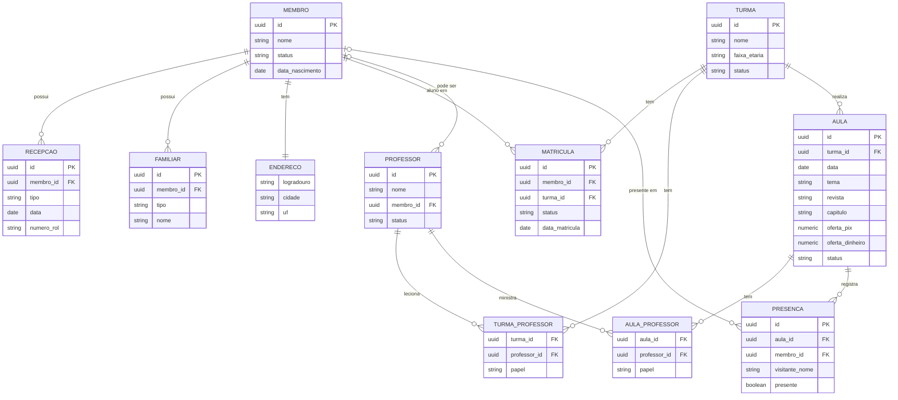
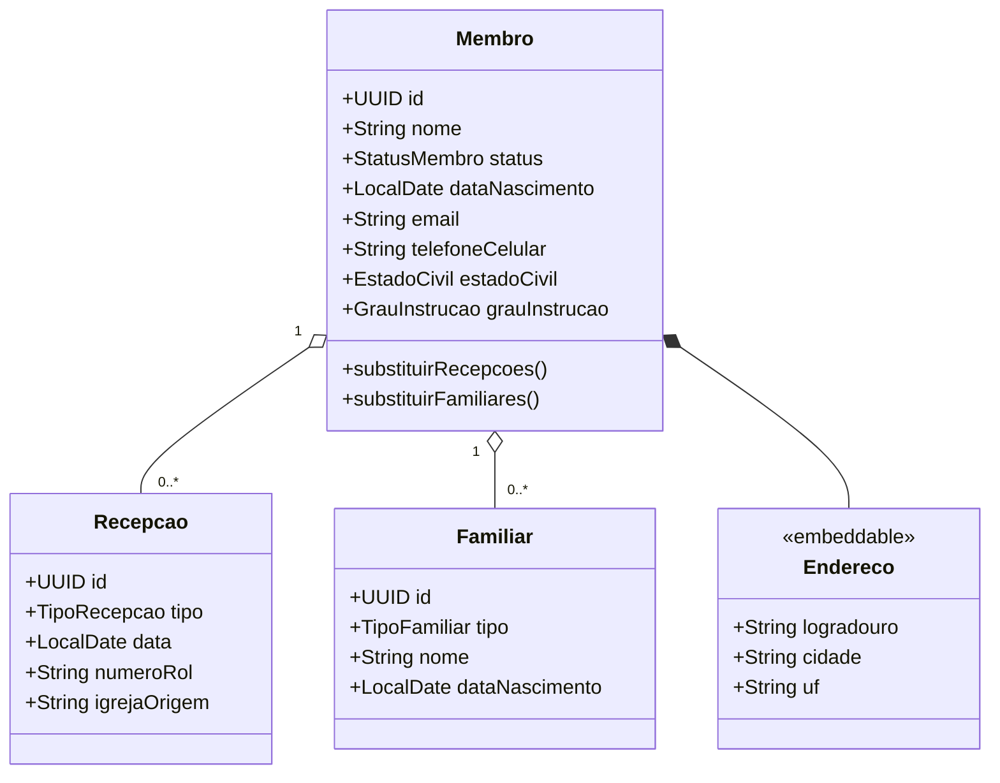
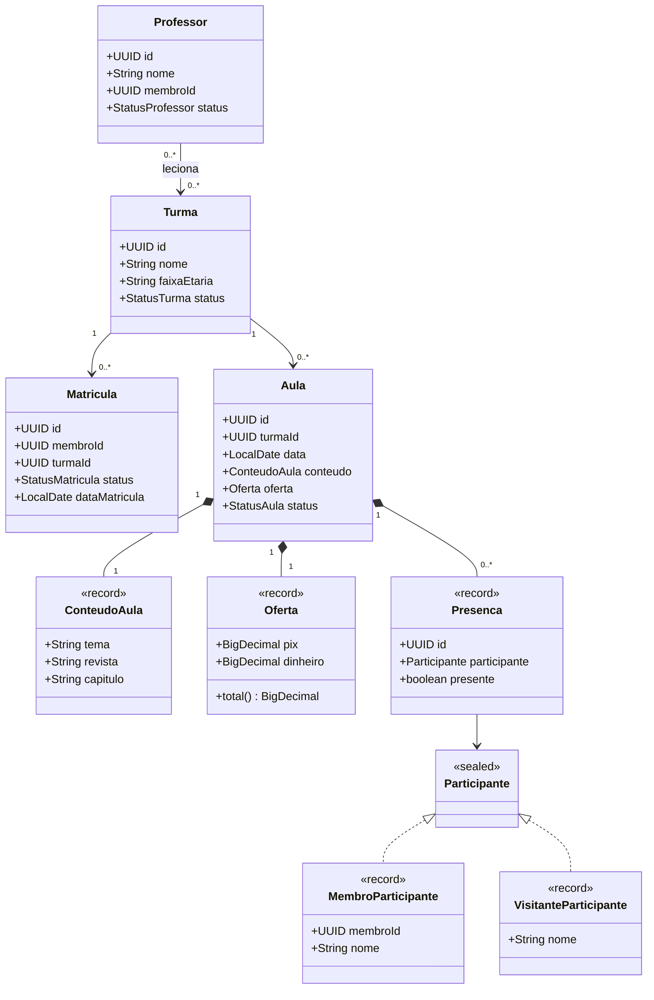

# Arquitetura

O Betelhub é um **monolito modular**: um único deploy, um único banco e
fronteiras internas bem definidas por módulos (*bounded contexts*). Cada módulo
vive em um pacote `com.betelhub.<modulo>` e se comunica por contratos públicos e
eventos de aplicação (Spring Modulith).

## Monorepo

```
betelhub/
├─ apps/
│  ├─ api/            # Backend Spring Boot
│  └─ web/            # SPA React + Vite
├─ collections/       # Collections HTTP (Bruno)
├─ docs/              # ADRs, DDD, diagramas C4, design system
├─ infra/             # Caddy e Terraform (Hostinger)
└─ docker-compose.yml # Ambiente local
```

## Backend

- Pacote-raiz: `com.betelhub`
- Núcleo compartilhado: `com.betelhub.nucleo` (configurações e tratamento de erros)
- Módulos com regra de negócio usam **arquitetura hexagonal** (domínio puro,
  aplicação, portas e adaptadores). CRUDs simples podem usar **camada fina**.

Estrutura interna dos módulos hexagonais implementados:

```
com.betelhub.<modulo>/
├─ dominio/       # entidades, value objects e eventos
├─ aplicacao/     # casos de uso e DTOs (records)
├─ porta/         # interfaces de saída (repositórios)
└─ adaptador/     # entrada/rest (controllers) e saida/persistencia (JPA)
```

### Status dos módulos

| Módulo | Status | Observação |
|---|---|---|
| `membro` | ✅ Piloto implementado | Cadastro completo + página própria no frontend |
| `escola_dominical` | ✅ Piloto implementado | Turmas, professores, matrículas, aulas, chamada, dashboard e relatórios |
| `identidade` | ⏳ Planejado | Auth via Zitadel/BFF ainda não implementado |
| `inquilino` | ⏳ Planejado | Multi-tenancy (RLS/`tenant_id`) ainda não implementado |
| `eventos` | ⏳ Planejado | — |
| `cursos` | ⏳ Futuro | — |
| `pastoral` | ⏳ Futuro | — |
| `financas` | ⏳ Futuro | — |
| `notificacoes` | ⏳ Planejado | — |

:::note[Autenticação no piloto]
A configuração de segurança atual libera as rotas (`permitAll`) e desliga CSRF
**temporariamente** para testes locais. O modelo final (Zitadel + BFF com sessão
opaca em cookie) ainda será implementado.
:::

## Banco de dados

PostgreSQL 17 com migrações versionadas via **Flyway**:

| Migração | Conteúdo |
|---|---|
| `V1__create_ebd_tables.sql` | Tabelas base da EBD |
| `V2__create_presencas_ebd.sql` | Presenças |
| `V3__modelo_ebd_completo.sql` | Modelo EBD completo |
| `V4__create_membros.sql` | Tabela de membros |
| `V5__membro_cadastro_completo.sql` | Campos do cadastro completo |

## Modelo de dados

Diagrama de entidades e relacionamentos das tabelas implementadas (Membros e EBD).



:::note
`Endereco` é `@Embeddable` (colunas `endereco_*` na tabela `membros`), não uma tabela própria.
Em `presencas_ebd`, exatamente uma coluna entre `membro_id` e `visitante_nome` é preenchida (`CHECK`).
:::

### Classes — Membros



### Classes — Escola Dominical (EBD)



## Frontend

SPA React que consome a API REST em `/api`. Organização por módulo:

```
apps/web/src/
├─ modules/
│  ├─ escola-dominical/   # pages, components e api da EBD
│  ├─ membros/            # pages e api de membros
│  └─ relatorios/         # página de relatórios
├─ shared/                # layout, tema, http e utilitários
├─ components/ui/         # componentes shadcn/ui
└─ mocks/                 # MSW (modo mock para desenvolvimento)
```

Detalhes em [Frontend](./frontend.md).
