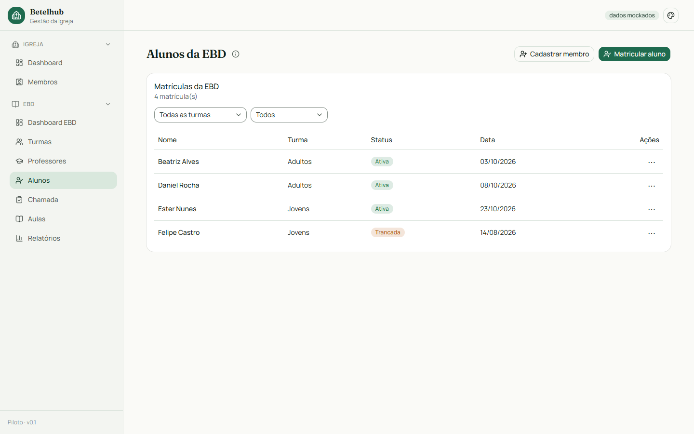

# Alunos

Rota: `/alunos` (`AlunosPage`)

Lista os alunos matriculados por turma e permite gerenciar as matrículas.

## O que a tela permite

- Selecionar a turma e ver seus alunos.
- Matricular um membro na turma.
- Alterar o status da matrícula (`ATIVA`/`TRANCADA`/`ENCERRADA`).
- Ver a data de matrícula de cada aluno.

Consome `GET /api/escola-dominical/turmas/{id}/alunos`,
`POST /api/escola-dominical/matriculas` e `PATCH .../matriculas/{id}/status`.
