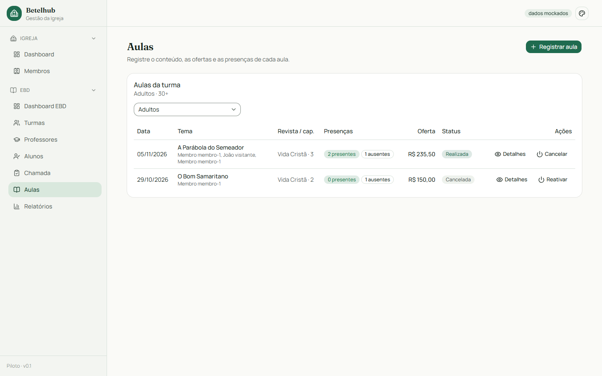
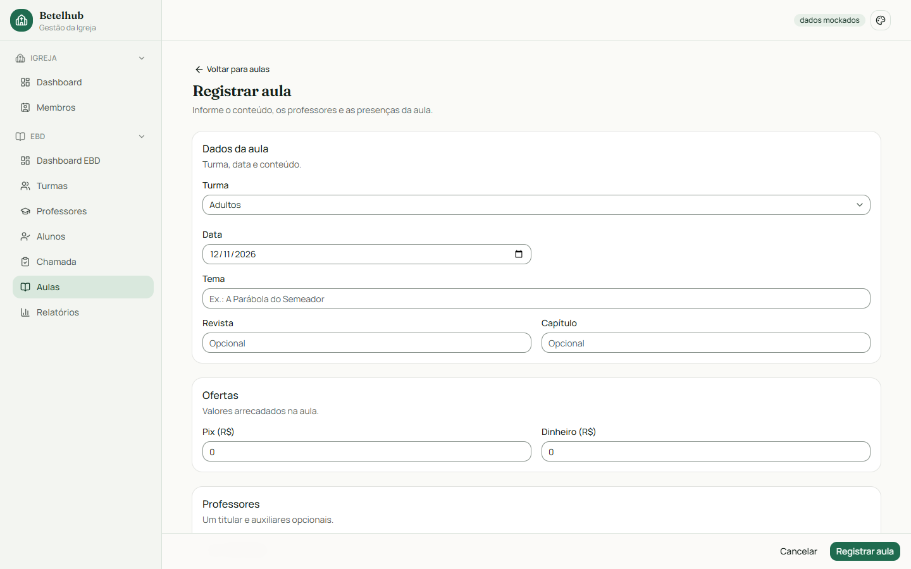
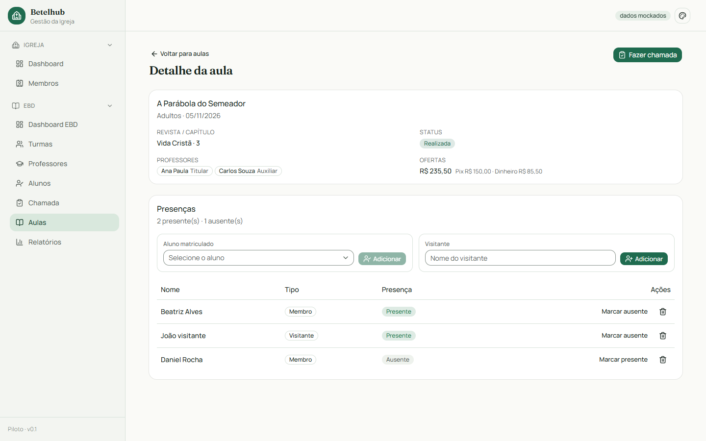

# Aulas

Rotas: `/aulas` (`AulasPage`), `/aulas/nova` (`NovaAulaPage`) e `/aulas/:id` (`AulaDetalhePage`)

Registro e consulta das aulas da escola dominical.

## Lista de aulas

## Nova aula

## Detalhe da aula

## O que as telas permitem

- Listar aulas com turma, data, tema, presentes e oferta.
- Registrar aula com conteúdo (tema, revista, capítulo), ofertas (PIX/dinheiro), professores e presenças.
- Ver o detalhe da aula e suas presenças.
- Alterar o status da aula (`REALIZADA`/`CANCELADA`).

Consome `POST/GET /api/escola-dominical/aulas` e `PATCH .../{id}/status`.
