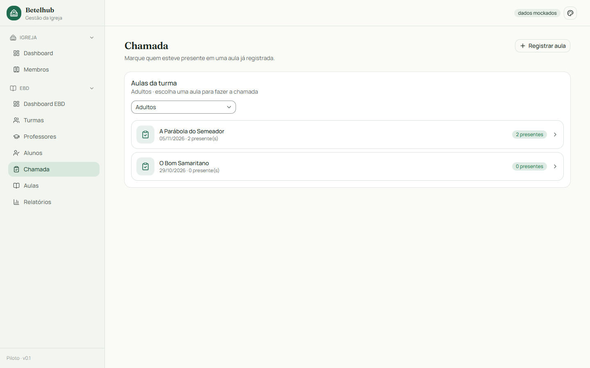
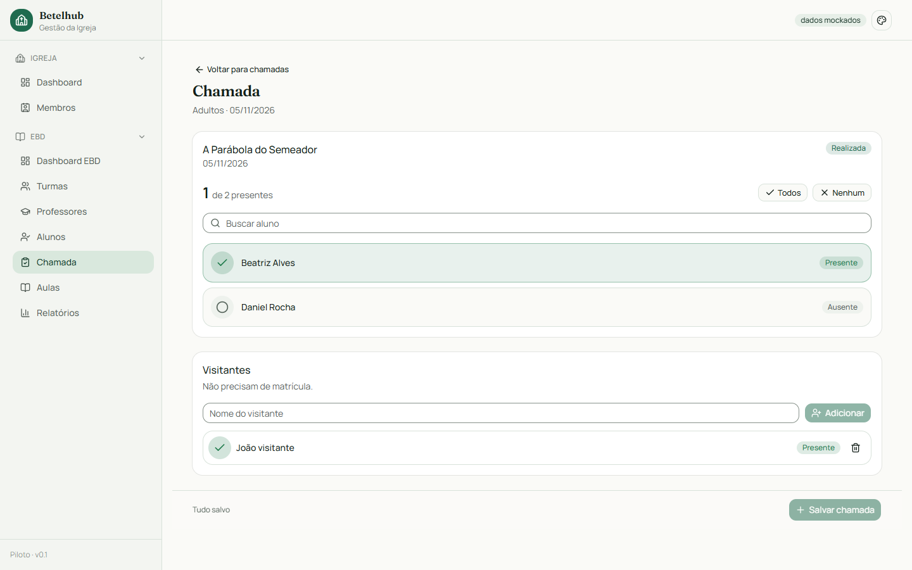

# Chamada

Rotas: `/chamadas` (`ChamadasPage`) e `/chamadas/:id` (`ChamadaPage`)

Registro de presença das aulas, por membro matriculado e por visitante.

## Lista de chamadas

## Realizar a chamada

## O que a tela permite

- Ver as chamadas das aulas registradas.
- Marcar presença/ausência de **alunos** matriculados.
- Adicionar **visitantes** avulsos.
- Salvar a chamada completa (visão de chamada).

Consome `GET/PUT /api/escola-dominical/aulas/{id}/chamada`.
