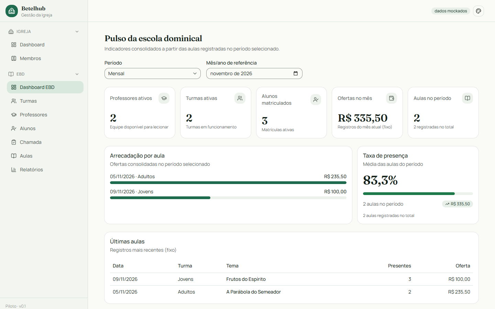

# Dashboard EBD

Rota: `/ebd` (`DashboardPage`)

Indicadores consolidados da escola dominical a partir das aulas registradas no
período selecionado.

## O que a tela mostra

- Filtros de **período** (`MENSAL`, `TRIMESTRAL`, `SEMESTRAL`, `ANUAL`) e mês/ano de referência.
- Cards de **professores ativos**, **turmas ativas**, **alunos matriculados**, **ofertas do mês** e **aulas no período**.
- Gráficos de **arrecadação por aula** e **taxa de presença**.
- Tabela de **últimas aulas**.

Consome `GET /api/escola-dominical/dashboard`.
