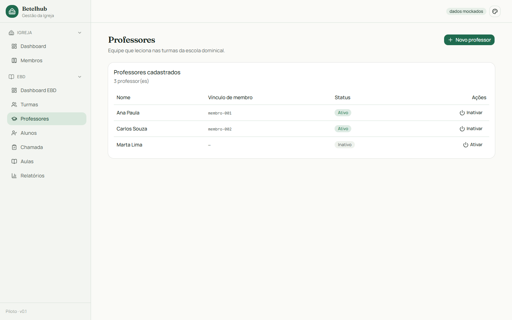

# Professores

Rota: `/professores` (`ProfessoresPage`)

Cadastro de professores da EBD, que podem estar vinculados a um membro.

## O que a tela permite

- Cadastrar professor (nome + membro opcional).
- Ativar/inativar professor.
- Vincular professores às turmas.

Consome `GET/POST /api/escola-dominical/professores` e `PATCH .../{id}/status`.
