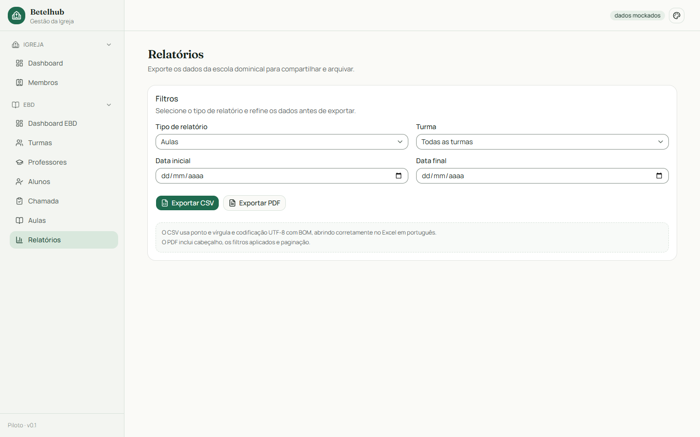

# Relatórios

Rota: `/relatorios` (`RelatoriosPage`)

Download de relatórios da EBD em **CSV** (UTF-8 com BOM) e **PDF** (OpenPDF).

## O que a tela permite

- Escolher o **tipo**: turmas, alunos, aulas ou professores.
- Escolher o **formato**: CSV ou PDF.
- Filtrar por turma e período (data inicial/final).
- Baixar o arquivo gerado.

Consome `GET /api/escola-dominical/relatorios/{tipo}.{csv|pdf}`.
