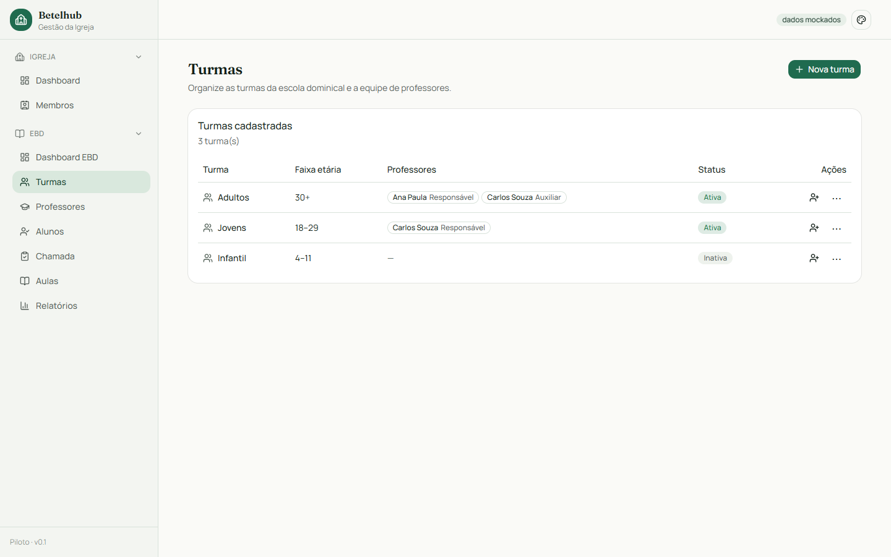

# Turmas

Rota: `/turmas` (`TurmasPage`)

Gerencia as turmas da EBD e o vínculo de professores responsáveis e auxiliares.

## O que a tela permite

- Criar turma com nome e faixa etária.
- Alterar o **status** da turma (`ATIVA`/`INATIVA`).
- Adicionar e remover professores da turma, definindo o papel (`RESPONSAVEL`/`AUXILIAR`).
- Abrir os alunos da turma.

Consome os endpoints de `/api/escola-dominical/turmas`.
