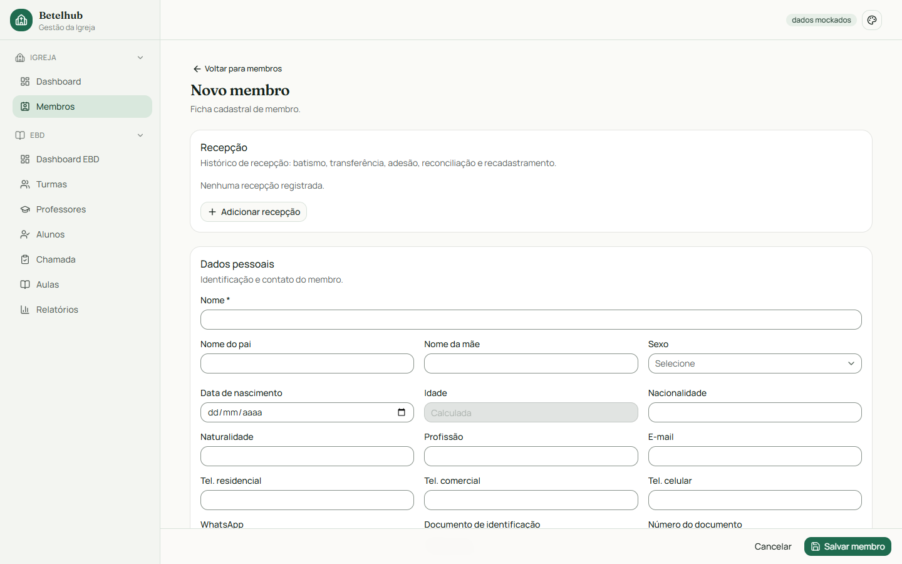
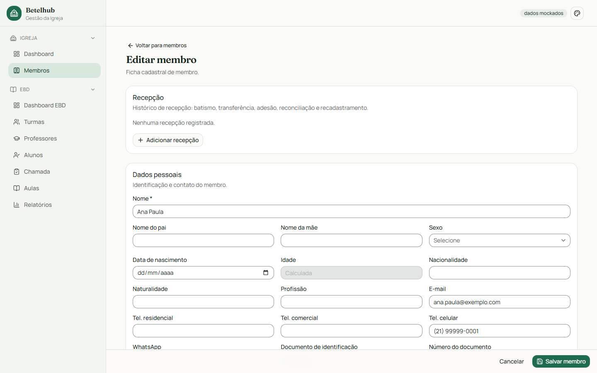

# Cadastro e edição de membro

Rotas: `/membros/novo` e `/membros/:id` (`MembroFormPage`)

Formulário completo de membro, dividido em seções (dados pessoais, contato,
documento, endereço, vida cristã, recepções e familiares).

## Novo membro

## Edição de membro

## O que o formulário permite

- Preencher e editar todos os dados do membro.
- Adicionar **recepções** e **familiares**.
- Salvar usando `POST /api/membros` (novo) ou `PUT /api/membros/{id}` (edição).
- Alterar o status do membro.
