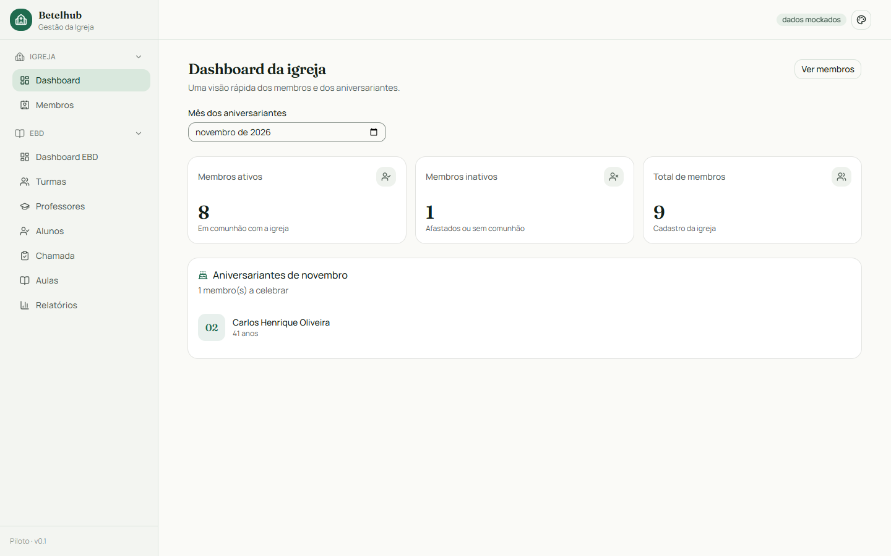

# Dashboard da igreja

Rota: `/` (`IgrejaDashboardPage`)

Visão rápida dos membros: totais de ativos, inativos e total, além dos
aniversariantes do mês selecionado.

## O que a tela mostra

- Seletor de **mês dos aniversariantes**.
- Cards de **membros ativos**, **inativos** e **total**.
- Lista de **aniversariantes** do mês com dia e idade.
- Atalho **Ver membros** para a listagem.

Consome `GET /api/igreja/dashboard`.
