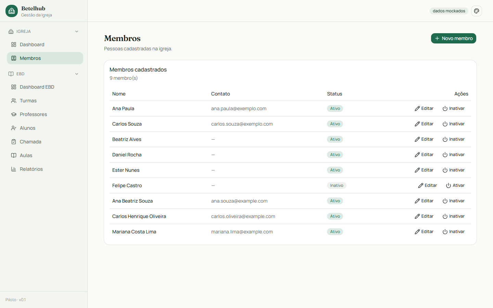

# Listagem de membros

Rota: `/membros` (`MembrosPage`)

Lista os membros cadastrados com nome, contato e status, permitindo abrir o
cadastro para edição ou iniciar um novo membro.

## O que a tela mostra

- Busca e listagem de membros.
- **Status** de cada membro (`ATIVO`/`INATIVO`).
- Ação **Novo membro** e acesso à edição.
- Alternância de status direto na listagem.

Consome `GET /api/membros` e `PATCH /api/membros/{id}/status`.
