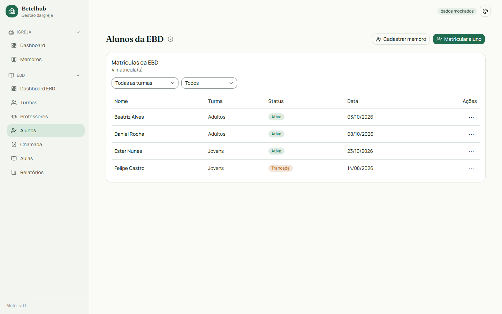

# Alunos

Gerencia quem está matriculado em cada turma da Escola Dominical.

## O que mostra

- Os alunos de uma turma e a data de matrícula.
- A **situação** de cada matrícula.

## O que você pode fazer

- Escolher a **turma**.
- **Matricular** um membro na turma.
- Alterar a situação da matrícula: **ativa**, **trancada** ou **encerrada**.

## Regras e particularidades

- O aluno é sempre um **membro já cadastrado**.
- Um aluno tem **no máximo uma matrícula ativa** por vez.
- Matrícula **trancada** ou **encerrada** não conta como aluno ativo.
- O cadastro da pessoa é feito em **Membros**; aqui só se gerencia o vínculo com a turma.

:::note[Detalhes técnicos]
[Ver API desta tela](/tecnico/modulos/escola-dominical/api/alunos)
:::
