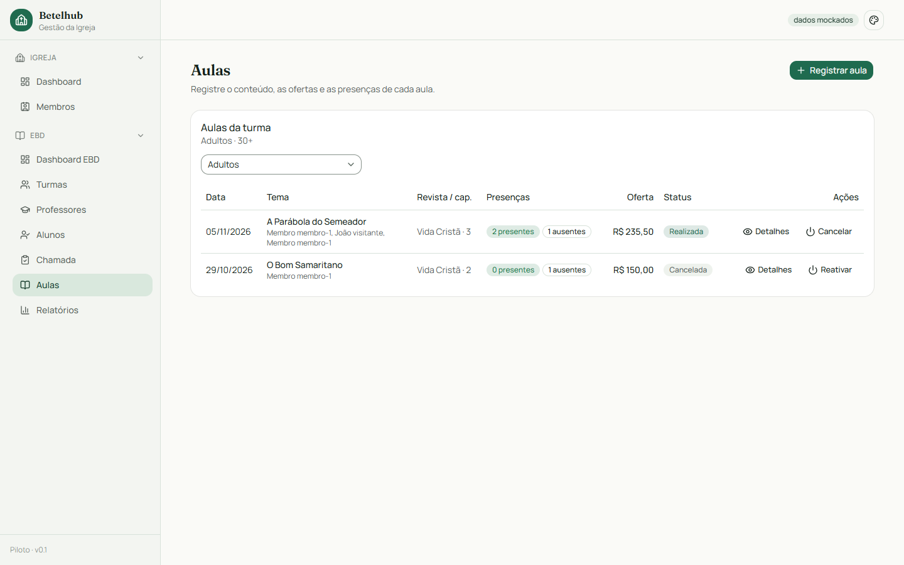
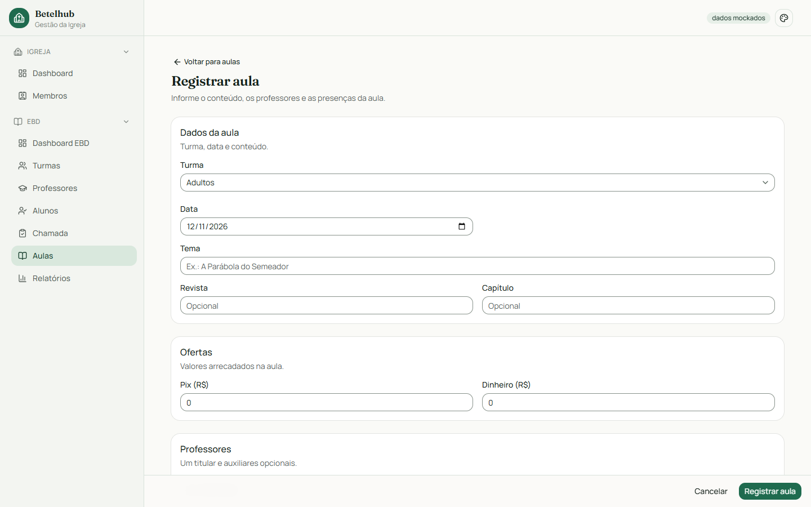
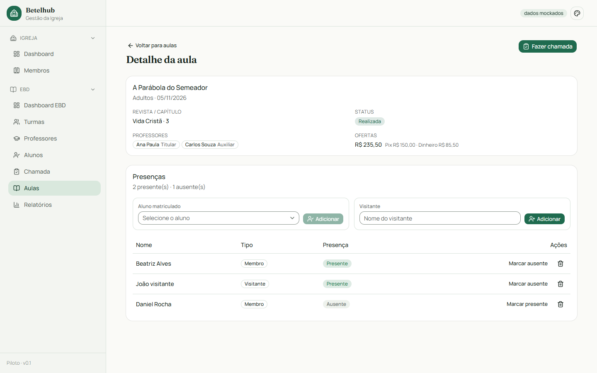

# Aulas

Registro e consulta das aulas da Escola Dominical.

## Lista de aulas

## Nova aula

## Detalhe da aula

## O que mostra

- Data, turma, tema, presentes e oferta de cada aula.
- O detalhe da aula com as presenças.

## O que você pode fazer

- **Registrar** uma aula com tema, revista, capítulo e oferta.
- Escolher o **professor titular** e os auxiliares.
- Ver o **detalhe** da aula.
- **Cancelar** ou reativar uma aula.

## Regras e particularidades

- A aula pertence a uma **turma** e a uma **data**.
- Cada aula tem **1 professor titular** e auxiliares opcionais.
- A **oferta** é a soma de PIX + dinheiro e não pode ser negativa.
- Aula **cancelada** não entra nos indicadores nem na arrecadação.

:::note[Detalhes técnicos]
[Ver API desta tela](/tecnico/modulos/escola-dominical/api/aulas)
:::
