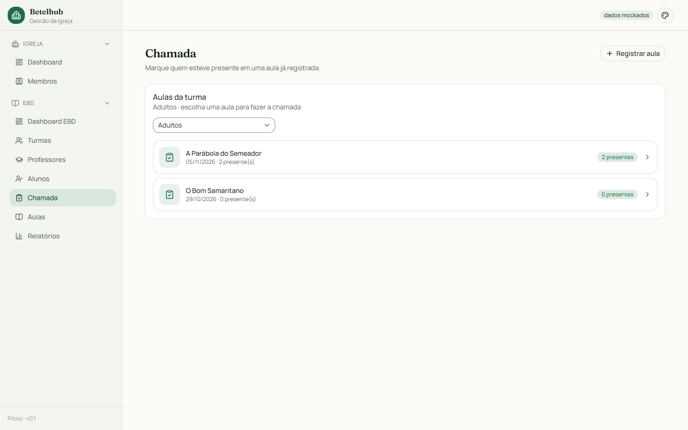
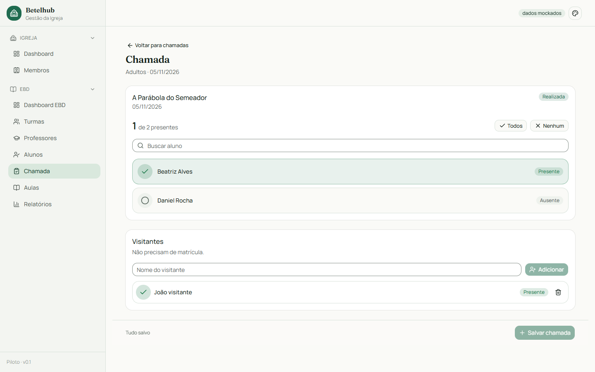

# Chamada

Registro de quem esteve presente em cada aula.

## Lista de chamadas

## Realizar a chamada

## O que mostra

- As aulas registradas e o resumo de presença de cada uma.
- Os alunos matriculados e os visitantes da aula.

## O que você pode fazer

- Marcar **presente/ausente** de cada aluno.
- Adicionar **visitantes** pelo nome.
- Salvar a chamada completa.

## Regras e particularidades

- Só é possível marcar presença de um **membro matriculado** na turma.
- Quem não é matriculado entra como **visitante** (apenas o nome).
- Visitantes podem se repetir; alunos não podem aparecer duplicados na mesma aula.
- A chamada pode ser ajustada depois, sem limite de prazo.

:::note[Detalhes técnicos]
[Ver API desta tela](/tecnico/modulos/escola-dominical/api/chamada)
:::
