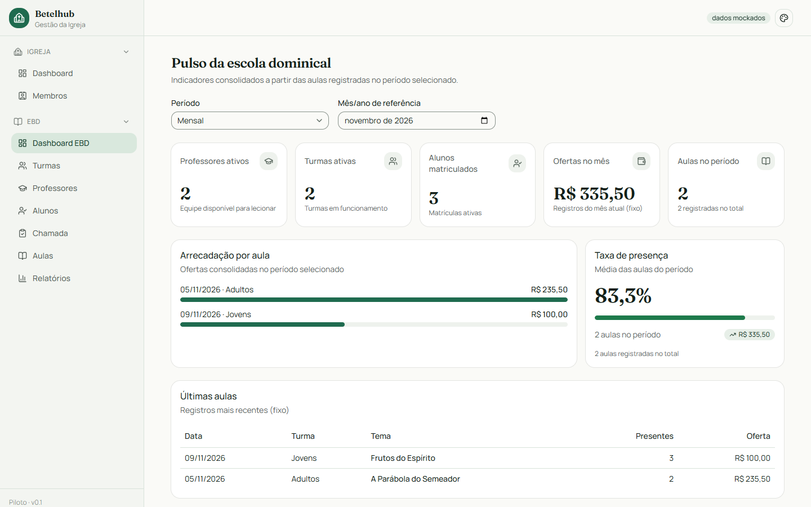

# Dashboard EBD

Mostra os números da Escola Dominical no período escolhido: equipe, turmas,
alunos, presença e ofertas.

## O que mostra

- **Professores ativos** e **turmas ativas**.
- **Alunos matriculados** (pessoas distintas com matrícula ativa).
- **Ofertas do mês** e **aulas no período**.
- Gráfico de **arrecadação por aula** e **taxa de presença**.
- Lista das **últimas aulas**.

## O que você pode fazer

- Escolher o **período**: mensal, trimestral, semestral ou anual.
- Escolher o **mês/ano** de referência.

## Regras e particularidades

- Apenas aulas **realizadas** entram nos indicadores.
- A **taxa de presença** é a média de presentes ÷ matriculados por aula.
- “Ofertas do mês” e “últimas aulas” ficam fixas no mês atual.
- Trimestre segue o calendário (Jan–Mar, Abr–Jun, Jul–Set, Out–Dez).

:::note[Detalhes técnicos]
[Ver API desta tela](/tecnico/modulos/escola-dominical/api/dashboard)
:::
