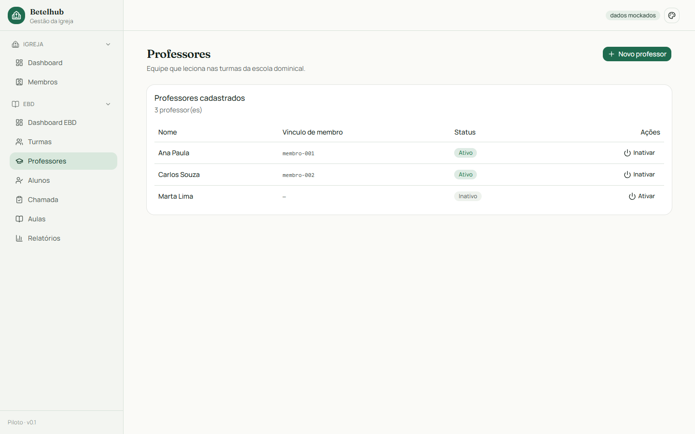

# Professores

Cadastro das pessoas que dão aula na Escola Dominical.

## O que mostra

- Nome, vínculo com membro (quando houver) e **situação**.

## O que você pode fazer

- **Cadastrar** um professor.
- **Ativar/inativar** um professor.
- Vincular o professor a uma **turma**.

## Regras e particularidades

- O professor pode ser um **membro** da igreja ou uma pessoa **externa**.
- O nome é obrigatório.
- Um professor inativo não deve receber novas aulas.

:::note[Detalhes técnicos]
[Ver API desta tela](/tecnico/modulos/escola-dominical/api/professores)
:::
