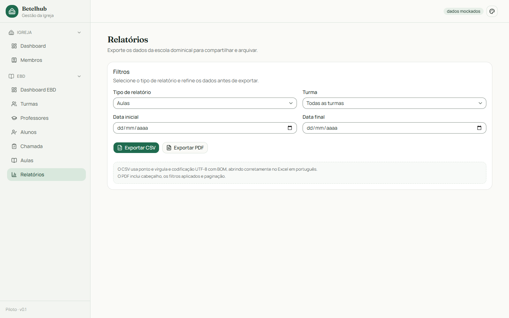

# Relatórios

Exporta os dados da Escola Dominical para compartilhar ou arquivar.

## O que mostra

- Opções de **tipo de relatório**, **turma** e **período**.

## O que você pode fazer

- Escolher o tipo: **turmas**, **alunos**, **aulas** ou **professores**.
- Filtrar por **turma** e por **período** (quando aplicável).
- Baixar em **CSV** (abre no Excel) ou **PDF**.

## Regras e particularidades

- O **CSV** usa ponto e vírgula e codificação que abre corretamente no Excel em português.
- O **PDF** inclui cabeçalho, filtros aplicados e numeração de páginas.
- Filtros de turma e período valem para alunos e aulas; os demais tipos ignoram filtros.

:::note[Detalhes técnicos]
[Ver API desta tela](/tecnico/modulos/escola-dominical/api/relatorios)
:::
