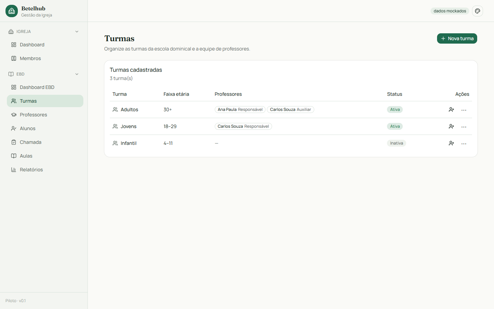

# Turmas

Organiza as turmas da Escola Dominical e a equipe de professores de cada uma.

## O que mostra

- Nome, faixa etária, professores e **situação** de cada turma.

## O que você pode fazer

- **Criar** uma turma.
- **Ativar/inativar** a turma.
- **Adicionar/remover professores**, definindo quem é **responsável** e quem é **auxiliar**.
- Abrir os **alunos** da turma.

## Regras e particularidades

- A turma pode ter **2–3 professores** que se revezam.
- Só existe **um responsável** por turma; os demais são auxiliares.
- Turma **inativa** não aparece para novas matrículas.

:::note[Detalhes técnicos]
[Ver API desta tela](/tecnico/modulos/escola-dominical/api/turmas)
:::
