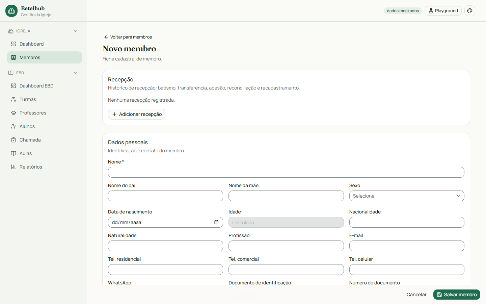
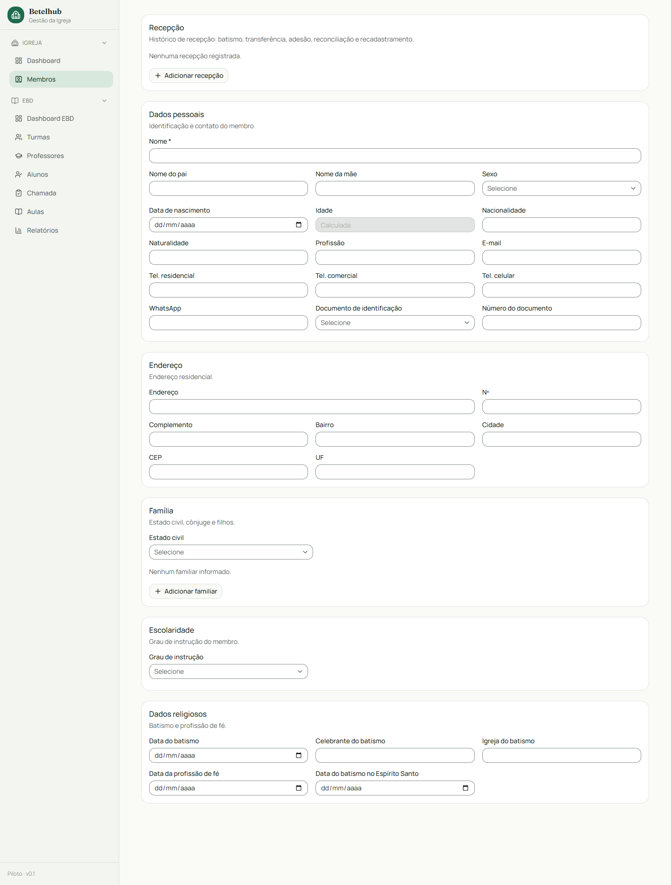
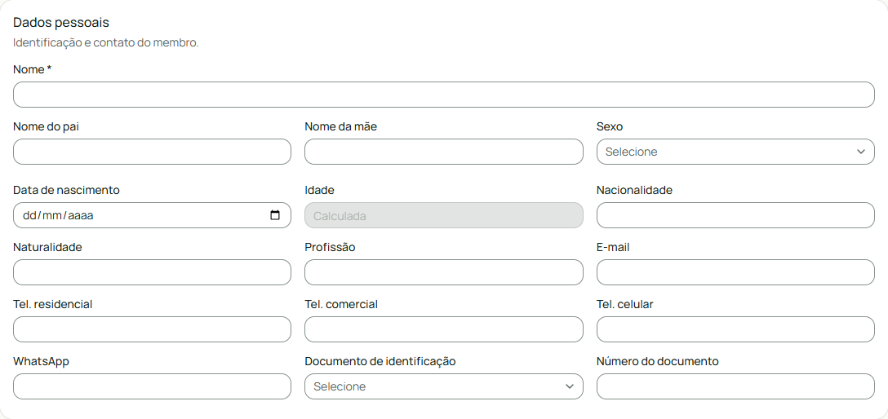
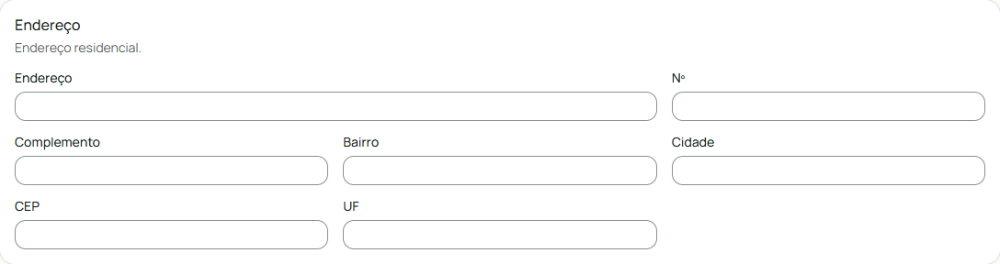
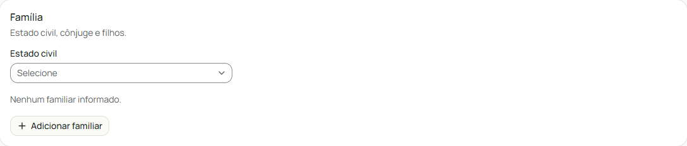
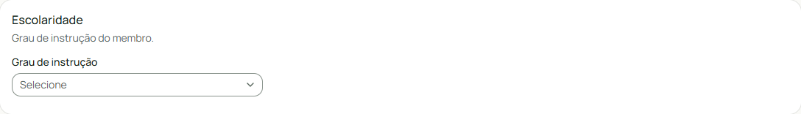
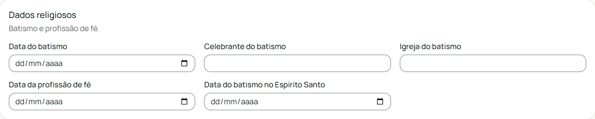
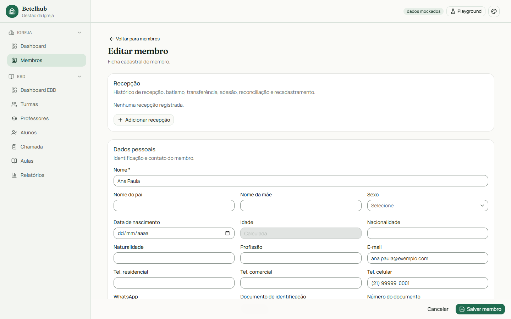

# Cadastro e edição de membro

A ficha completa do membro, organizada em seções. Serve tanto para cadastrar
quanto para editar uma pessoa.

## Novo membro

## Formulário completo

Visão de todas as seções da ficha.

### Recepção

Histórico de como a pessoa foi recebida na igreja.

### Dados pessoais

Identificação e contato do membro.

### Endereço

Endereço residencial.

### Família

Estado civil, cônjuge e filhos.

### Escolaridade

Grau de instrução do membro.

### Dados religiosos

Batismo e profissão de fé.

## Edição de membro

## O que a ficha contém

- **Recepção**: como a pessoa foi recebida (batismo, transferência, adesão, reconciliação ou recadastramento).
- **Dados pessoais**: nome, pai, mãe, sexo, nascimento, nacionalidade, naturalidade e profissão.
- **Contato**: e-mail e telefones.
- **Documento**: RG, CNH ou passaporte.
- **Endereço** completo.
- **Família**: estado civil, cônjuge e filhos.
- **Escolaridade**: grau de instrução.
- **Dados religiosos**: batismo, profissão de fé e batismo no Espírito Santo.

## Regras e particularidades

- O **nome** é obrigatório.
- Um membro novo entra como **ativo**.
- Ao salvar, as listas de **recepções** e **familiares** são gravadas exatamente como enviadas.
- Endereço em branco não é gravado.

:::note[Detalhes técnicos]
[Ver API desta tela](/tecnico/modulos/membros/api/cadastro-edicao)
:::
