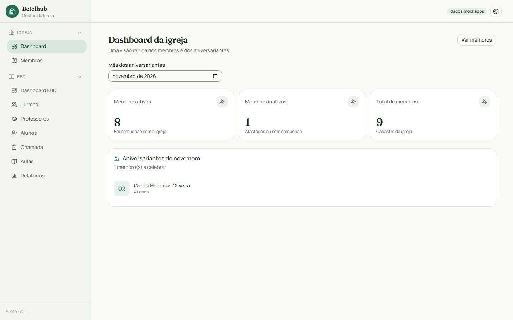

# Dashboard da igreja

É a primeira tela ao entrar no sistema. Dá uma visão rápida da igreja e dos
aniversariantes do mês.

## O que mostra

- Quantidade de **membros ativos**, **inativos** e o **total**.
- Os **aniversariantes** do mês selecionado (dia e idade).
- Atalho para a lista de membros.

## O que você pode fazer

- Escolher o **mês** dos aniversariantes.
- Ir para **Membros** para cadastrar ou editar.

## Regras e particularidades

- **Ativo** = em comunhão com a igreja; **Inativo** = afastado ou sem comunhão.
- A idade é calculada pela data de nascimento.
- O total soma ativos e inativos.

:::note[Detalhes técnicos]
[Ver API desta tela](/tecnico/modulos/membros/api/dashboard-igreja)
:::
