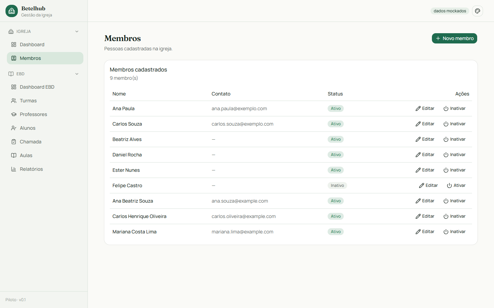

# Listagem de membros

Mostra as pessoas cadastradas na igreja e permite abrir a ficha ou mudar a
situação do membro.

## O que mostra

- Nome, contato e **situação** de cada membro.
- Acesso rápido à ficha completa.

## O que você pode fazer

- **Cadastrar** um novo membro.
- Abrir a ficha para **editar**.
- **Ativar/inativar** um membro.

## Regras e particularidades

- Não existe exclusão: o membro fica **inativo**.
- Pode haver pessoas com o mesmo nome (homônimos).
- A listagem mostra um **resumo**; os detalhes ficam na ficha.

:::note[Detalhes técnicos]
[Ver API desta tela](/tecnico/modulos/membros/api/listagem)
:::
